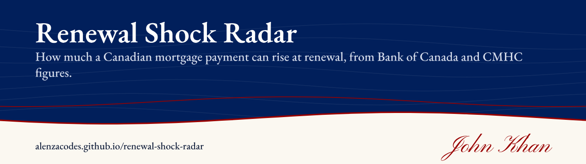
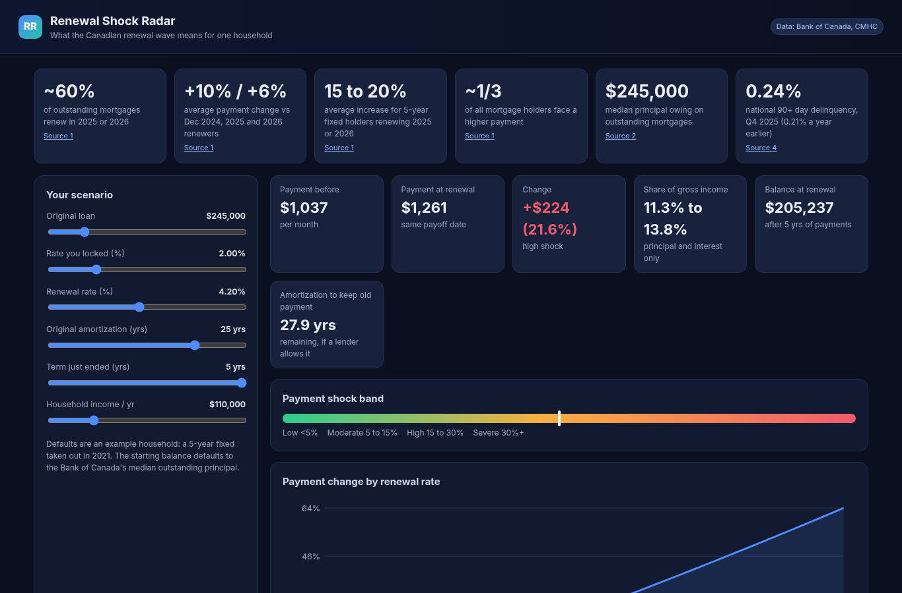
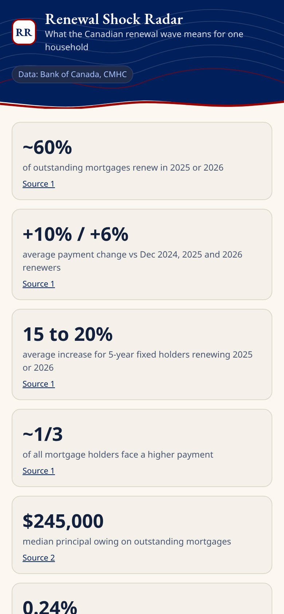

# Renewal Shock Radar

**Estimates how much a Canadian mortgage payment can rise at renewal, using Bank of Canada and CMHC figures, with your own loan inputs.**

   

**Live:** https://alenzacodes.github.io/renewal-shock-radar/

A lot of Canadians who locked in a 5-year fixed in 2020 and 2021 are renewing at rates two or three points higher. This page shows what that means for one household. It starts from an example (a 5-year fixed taken out in 2021, at the Bank of Canada's median outstanding balance) and lets you swap in your own balance, rate and amortization.

## What it does

- The national picture: how many mortgages renew each year, from CMHC
- Your new payment and the change in dollars and percent
- A shock band: low (under 5%), moderate (5 to 15%), high (15 to 30%) or severe (30% and up)
- A chart of how the payment moves across a range of renewal rates

## Quick start

Open `index.html` or serve the folder with `python3 -m http.server 8000` and open http://localhost:8000/. No install.

## Tests

    node tests/test.js

15 checks on the payment and remaining balance math, the shock calculation and the band cut-offs. They run on every push.

## Data and sources

- Bank of Canada staff analytical notes on mortgage renewals: https://www.bankofcanada.ca/2025/01/staff-analytical-note-2025-1/ and https://www.bankofcanada.ca/2025/07/staff-analytical-note-2025-21/
- CMHC Residential Mortgage Industry Report, Fall 2025: https://www.cmhc-schl.gc.ca/professionals/housing-markets-data-and-research/housing-research/research-reports/housing-finance/residential-mortgage-industry-report
- CMHC, renewal wave release (2026): https://www.cmhc-schl.gc.ca/media-newsroom/news-releases/2026/renewal-wave-peaks-still-dominates-mortgage-market
- Interest Act (semi-annual compounding): https://laws-lois.justice.gc.ca/eng/acts/i-15/page-1.html

On a phone:

Educational only, not financial advice.

## Limits

- The example household and the renewal counts are national figures. Your lender, term and prepayments change the result.
- Payments use semi-annual compounding for fixed rates. Variable-rate mortgages with fixed payments behave differently at renewal.

## Files

    index.html, style.css   the page
    app.js                  national figures, household inputs and notes
    calc.js                 payment, balance and shock-band maths, usable in Node
    charts.js               small SVG charts, no libraries
    tests/test.js           unit tests

## Licence

MIT. Copyright 2026 John Khan.

---

More of my work is on my [GitHub profile](https://github.com/ALENZACODES).
